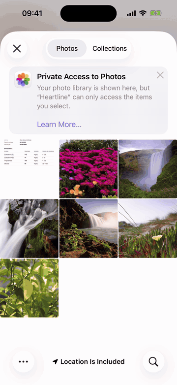
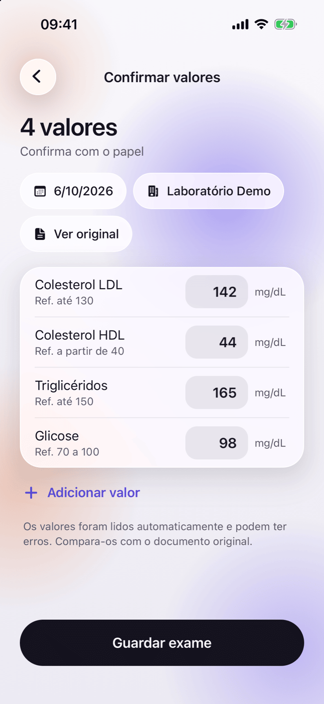
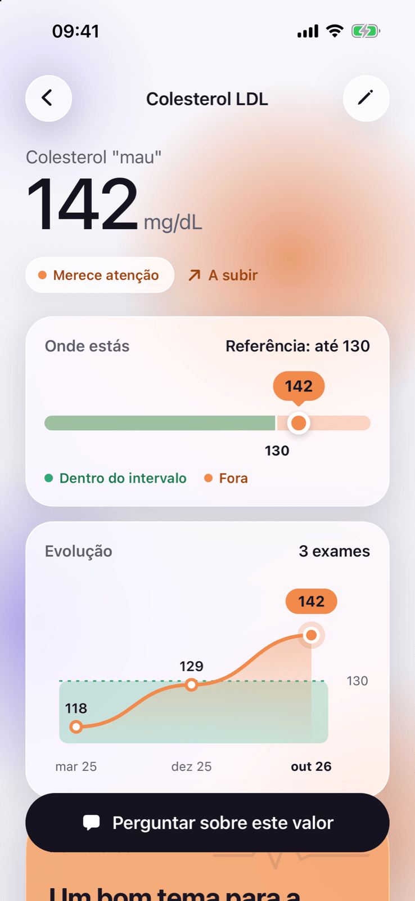
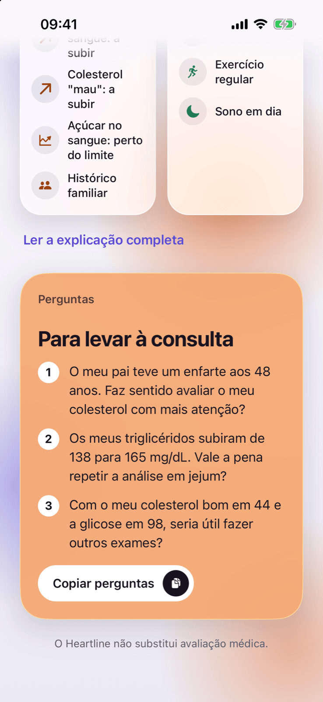

<p align="center">
  <picture>
    <source media="(prefers-color-scheme: dark)" srcset="assets/images/splash-logo-dark.png">
    
  </picture>
</p>

<h1 align="center">Heartline</h1>

<p align="center">A native iOS app that helps anyone understand their clinical exams —<br>integrated, longitudinal, and personalized.</p>

<p align="center">
  
</p>

<table align="center">
  <tr>
    <td align="center" width="200"></td>
    <td align="center" width="200"></td>
    <td align="center" width="200"></td>
    <td align="center" width="200"></td>
  </tr>
  <tr>
    <td align="center"><sub>Dashboard</sub></td>
    <td align="center"><sub>Confirming extracted values</sub></td>
    <td align="center"><sub>Biomarker detail</sub></td>
    <td align="center"><sub>Questions for the doctor</sub></td>
  </tr>
</table>

<p align="center"><sub>
  Synthetic data only (see <a href="#demo-data">Demo data</a>). The UI is in European Portuguese, the launch market.<br>
  <a href="docs/demo.mp4">Full walkthrough (45 s)</a> · <a href="docs/screenshots/04-analysis.png">AI analysis screen</a>
</sub></p>

## What it does

Heartline crosses all your exam data over time — with family history and
lifestyle — and explains what the **combination** of your data suggests, in
clear language with concrete actions.

- **Photograph or import** clinical exams (camera, gallery, or PDF)
- **AI extraction** of biomarker values, units, and the lab's own reference
  ranges — with per-value confidence and a mandatory confirmation step where
  the user reviews and can edit everything before anything is saved
- **Deterministic scoring** — 4 attention levels computed by pure functions
  from ranges, trends, and family history; never by the AI
- **Personalized narrative** — AI-generated insights that connect data points
  across exams, with server-side language validation
- **Doctor questions** — ready-to-use, context-aware questions for the next
  appointment
- **Ask AI** — chat about your own health data, with guardrails
- Light and dark UI built on native iOS Liquid Glass, native tabs and SF
  Symbols, with an animated companion, restrained haptics, and SVG charts

## What it is NOT

- Not a medical device
- Not a diagnostic tool
- Does not calculate clinical risk scores
- Does not recommend medication or treatment

Heartline is a **health literacy tool** — it helps you have better
conversations with your doctor, not replace them. In a health product, scope
restraint is a feature: these limits are documented, encoded in the language
rules below, and enforced server-side.

## Technical highlights

For anyone arriving from a CV, the 60-second version:

- **The AI never classifies.** Attention levels come from deterministic pure
  functions ([`lib/scoring.ts`](lib/scoring.ts)): range-type-aware severity
  and proximity (bounded, max-only, min-only ranges are scored differently),
  direction-aware trend (a rising HDL is not a rising LDL), and family
  history. The same module runs in the app and in the Edge Functions, so the
  LLM receives the computed attention levels as ground truth and only
  explains them — classification is code, reviewable and unit-tested.
- **Server-side guardrails on language.** Every AI output is validated in the
  Edge Function against forbidden clinical words ("risco", "diagnóstico",
  imperative "deves"…) and replaced with a deterministic fallback when
  validation fails. The app's language rules are enforced, not hoped for.
- **Privacy by architecture.** Edge Functions identify the caller from the
  session JWT and query through Row Level Security — a profile id is never
  accepted from the request body. The model receives a minimised summary (age
  instead of birth date, no name, no ids). The session lives in the iOS
  Keychain, the original document goes to a private per-user Storage folder,
  GDPR consent is recorded before the first exam, and account deletion removes
  files, rows and the auth user.
- **Reference ranges from the source.** Scoring uses the lab's own reference
  ranges, extracted from the report next to each value and editable at
  confirmation — because ranges differ between labs. A curated list of 15
  common biomarkers powers manual entry.
- **One canonical key per biomarker.** Labs (and LLMs) name the same marker
  in many ways; a catalog of canonical keys and aliases groups readings across
  exams, and readings in a different unit are kept out of the trend instead of
  being silently mixed.
- **Human-in-the-loop by design.** AI extraction carries a confidence level
  per value and nothing reaches the database without the user confirming it.

## How it works

```
photo / PDF
   │  photos compressed on-device
   ▼
Edge Function: extract-exam ──► Gemini 2.5 Flash   (caller = session JWT)
   │  values + units + lab reference ranges + per-value confidence
   ▼
Confirmation screen — user reviews and edits every value, date and lab
   ▼
Supabase Postgres (exams, biomarkers) — Row Level Security
   │  original document → private Storage bucket, <user id>/<exam id>
   ▼
health-model — deterministic attention level per biomarker (app + functions)
   ▼
Edge Functions: generate-narrative · generate-questions · ask-question
   │  scored summary in, output validated against forbidden words
   ▼
Dashboard · biomarker detail · analysis + chat
```

## Data & storage

| Data | Comes from | Lives in |
|---|---|---|
| Biomarker values, units, ranges | Gemini extraction from the photo/PDF, confirmed by the user — or manual entry | `biomarkers` table (Postgres, RLS) |
| Exam photos / PDFs | Camera, gallery, or file picker | Private `exams` Storage bucket, one folder per user (RLS); deleted with the exam or the account |
| Profile + family history | 3-step onboarding (taps, not typing) | `profiles`, `family_history` (RLS) |
| AI narrative, questions, chat | Edge Functions (cached to avoid re-generation) | `generated_content` (RLS) |
| Session tokens | Supabase Auth | iOS Keychain / Android Keystore (`expo-secure-store`) |
| GDPR consent | Checkbox on the add-exam screen, before the first exam | `profiles.health_consent_at` |
| Reference defaults for manual entry | 15 curated common biomarkers | [`constants/biomarkers.ts`](constants/biomarkers.ts) |

Notes:

- **Gemini 2.5 Flash** is called exclusively from Deno Edge Functions
  (`extract-exam`, `generate-narrative`, `generate-questions`,
  `ask-question`) — the API key never ships in the app, and rate limits are
  surfaced to the user as a friendly retry message. Health data of EU users
  must go through a **paid** Gemini tier: the free tier is not offered for EEA
  end users and its inputs may be used to improve Google's products.
- **Row Level Security** means every query is scoped to `auth.uid()` at the
  database level — a compromised client still cannot read another user's rows.
  The Edge Functions use the caller's JWT, so they are bound by the same
  policies; the service role is used only by `delete-account`.
- **Not wired into the UI yet:** the HealthKit hook
  ([`hooks/useHealthKit.ts`](hooks/useHealthKit.ts)) and Google Sign-In
  ([`components/social-auth-buttons.tsx`](components/social-auth-buttons.tsx))
  are implemented but no screen exposes them. Sign in with Apple is not
  implemented (required by App Store guideline 4.8 before Google Sign-In ships).

## Scoring system

Four attention levels, determined by reference-range type + trend + family
history:

| Level | Color | Meaning |
|-------|-------|---------|
| Dentro do esperado | Green | Within reference range |
| A acompanhar | Amber | Near the edge or trending the wrong way |
| Merece atenção | Amber | Borderline + family history or an adverse trend |
| Fora do range | Red | Outside reference range |

Mechanics: **severity** measures how far outside the range a value is
(normalized to the range width), **proximity** how close to the edge a
within-range value sits, and **trend** compares readings over time (>10 %
change). A trend only counts when it moves the value towards the limit that
matters — rising towards a maximum, falling towards a minimum — and for
"higher is better" markers (HDL, eGFR) the lab's upper bound is ignored.
Family history escalates borderline cardiovascular markers. All of it is plain
TypeScript in
[`supabase/functions/_shared/health-model.ts`](supabase/functions/_shared/health-model.ts)
(re-exported by `lib/scoring.ts`), covered by `npm test` — no AI in the loop.

## Language rules

The app follows strict language guidelines (Portuguese, Portugal):

- Never uses "risco", "diagnóstico", "normal/anormal"
- Uses "contexto", "merece atenção", "dentro do range de referência"
- Uses "vale a pena", "faz sentido" instead of "deves", "precisas"
- AI outputs are validated server-side for forbidden words, with
  deterministic fallbacks

## Security

What the backend enforces, and where to verify it:

- **JWT verified on every Edge Function.** Functions are deployed with gateway
  JWT verification on (no `--no-verify-jwt`), and each handler additionally
  resolves the caller itself: `serveAuthenticated` → `requireUser` in
  [`supabase/functions/_shared/runtime.ts`](supabase/functions/_shared/runtime.ts)
  rejects any request without a valid session before touching data.
- **The profile id comes from the token, never from the request.** No function
  accepts a `profileId` (or any user id) in the body; the id is the
  authenticated user's. A valid token for user A cannot ask about user B.
- **RLS applies to everything read on behalf of the user.** Functions query
  through a client bound to the caller's JWT, so the same Row Level Security
  policies that protect the app protect the functions.
- **Service role only where it is unavoidable.** `delete-account` is the only
  function that uses it — to remove the user's Storage files and the
  `auth.users` row. Nothing else can bypass RLS.
- **Untrusted input stays data.** The chat question is passed to the model as
  quoted text with a length cap, uploads are limited by size and MIME type,
  and every model output is checked against the language rules before it is
  stored or returned.
- **Secrets and tokens.** The Gemini key lives in function secrets and is sent
  in a header, never in a URL. On the device, the session is stored in the
  Keychain/Keystore, not in plain storage.

## Testing

The parts that decide what a user is told are pure functions with unit tests
(Jest, 26 tests):

- [`__tests__/scoring.test.ts`](__tests__/scoring.test.ts) covers
  [`lib/scoring.ts`](lib/scoring.ts): canonical keys and aliases, range
  classification, severity and proximity per range type, trend detection,
  direction-aware adverse trends (a falling HDL, a rising LDL), the four
  attention levels, and aggregation across exams — including readings in a
  different unit being kept out of the trend.
- [`__tests__/number-dates.test.ts`](__tests__/number-dates.test.ts) covers
  decimal parsing with a comma (`0,9`) and date handling that does not shift a
  day across timezones.

```bash
npm test                 # all suites
npm test -- scoring      # only the scoring suite
npm test -- --watch      # re-run on change
```

CI ([`.github/workflows/ci.yml`](.github/workflows/ci.yml)) runs typecheck,
lint and tests on every push, plus `deno check` on the Edge Functions.

## Tech stack

- **React Native** with **Expo SDK 54** (managed workflow, New Architecture)
- **TypeScript** throughout, including the Deno Edge Functions
- **Expo Router** (file-based routing, typed routes)
- **expo-glass-effect**, **expo-symbols**, native tabs and **Reanimated** for the iOS-native look and motion
- **Supabase** (PostgreSQL + Auth + Row Level Security + Storage + Edge Functions)
- **TanStack Query** for shared, cached server state across screens
- **Google Gemini 2.5 Flash** via Edge Functions (API keys never in the app)
- **react-native-svg** for sparklines and charts
- **expo-haptics**, used sparingly (choices, primary actions, results)

## Getting started

### Prerequisites

- Node.js 18+
- Supabase project with the schema from `supabase/migrations/`
- One of:
  - **Expo Go** on your iPhone (quickest, but some features disabled — see below)
  - **Xcode** for the iOS simulator or a dev client build (full feature set)

### Setup

```bash
# Install dependencies
npm install

# Copy environment variables
cp .env.example .env
# Fill in EXPO_PUBLIC_SUPABASE_URL and EXPO_PUBLIC_SUPABASE_ANON_KEY
```

### Demo data

To explore the app without entering real exams, seed a demo account with
**synthetic** data — a 28-year-old man whose father had a heart attack at 48,
with LDL rising across three exams:

```bash
npx tsx --env-file=.env scripts/seed-demo.ts
```

The script asks for the project's service-role key and a password, then
creates (or resets) `demo@example.com`, its profile, family history and exams.
The key is used only by this local script and is never stored. Pass
`--without-latest` to leave the most recent exam out and add it through the
app with [`docs/demo/synthetic-lab-report.png`](docs/demo/synthetic-lab-report.png),
a fictitious lab report made for that purpose.

### Checks

```bash
npm run typecheck   # tsc
npm run lint        # eslint (expo config)
npm test            # jest — scoring, catalog, number and date parsing
npx deno check supabase/functions/*/index.ts
```

### Running in Expo Go (quickest)

This project has `expo-dev-client` installed, so `npx expo start` defaults to
dev-client mode (URL scheme `exp+heartline://`) — **Expo Go cannot open
that**. Force Expo Go mode with `--go`:

```bash
npx expo start --go --clear
```

Then on the iPhone:

1. Make sure the phone is on the **same Wi-Fi** as the Mac.
2. Open the **Expo Go** app (modern iOS Expo Go has no QR scanner — iPhone
   Camera and Safari cannot open `exp://` URLs).
3. On Expo Go's Home tab, the running project appears automatically under
   **"Development servers"**. Tap it.
4. If it doesn't appear, tap the paste-URL button (bottom-right of Home) and
   paste `exp://<your-mac-ip>:8081` (the Metro terminal prints the IP).

**Features disabled in Expo Go** (require a dev client build):
- HealthKit (`@kingstinct/react-native-healthkit`)
- Google Sign-In (`@react-native-google-signin/google-signin`)
- Apple Sign-In (`expo-apple-authentication`)

The rest of the app (email/password auth, adding exams, dashboard, AI
narrative) works fine for iterating on UI and logic.

### Running in the iOS simulator

Full feature set, no phone needed. Requires Xcode.

```bash
npm run ios
```

First build takes 5–10 minutes; subsequent runs are fast. You can also press
`i` in the Metro terminal to open the simulator.

### Running a dev client on a physical device

Full feature set on your real phone. Requires an EAS account:

```bash
npx eas-cli build --profile development --platform ios
```

Install the resulting build via TestFlight or Apple Configurator. Then
`npx expo start` (no `--go`) and the dev client opens the project
automatically.

### Deploy the backend

```bash
# Schema, indexes, consent column, private `exams` bucket + policies
npx supabase db push

# Secret used by the AI functions
npx supabase secrets set GEMINI_API_KEY=...

# Edge Functions — JWT verification stays on (the default)
npx supabase functions deploy extract-exam generate-narrative generate-questions ask-question delete-account
```

Do not pass `--no-verify-jwt`: the gateway rejects unauthenticated calls, and
each function also resolves the caller itself (`requireUser` in
`supabase/functions/_shared/runtime.ts`). In Supabase Auth, add `heartline://reset-password` to the allowed
redirect URLs for the password-recovery deep link.

## Project structure

```
app/                          # Expo Router screens
├── (auth)/                   # Login, register, welcome, forgot-password
├── (onboarding)/             # About you, habits, family history (3 steps)
├── (tabs)/                   # Native tabs: home, values, add-exam, ask, profile
├── confirm-values.tsx        # Review/edit extracted values before saving
├── reset-password.tsx        # Password-recovery deep link (PKCE)
├── analysis.tsx              # Summary: what weighs, what helps, doctor questions
├── biomarker/[id].tsx        # Biomarker detail with range bar + evolution chart
└── _layout.tsx               # Root layout with auth flow + splash screen

components/                   # Reusable components
├── ui/                       # Glass, Screen, Icon, Button, Chip, Input, Sheet, List…
├── mascot.tsx                # Animated companion; colour follows the attention level
├── exam/                     # Extraction screen and scan illustration
├── range-bar.tsx             # Value position within the lab range (full and mini)
├── evolution-chart.tsx       # Time-scaled chart with reference band
├── family-history-form.tsx   # Shared by onboarding and settings
├── donut.tsx                 # One ring segment per value, by attention level
└── sparkline.tsx             # Mini SVG trend chart

hooks/                        # Custom hooks
├── useAuth.tsx               # AuthProvider + session state
├── useProfile.ts             # Profile + family history (TanStack Query)
├── useBiomarkers.ts          # Exams + biomarkers, scored client-side
├── useHealthKit.ts           # Apple Health (lazy-loaded; not wired into the UI)
└── useGeneratedContent.ts    # AI narrative + questions, shared regeneration

lib/                          # Core logic
├── supabase.ts               # Supabase client
├── secure-storage.ts         # Session storage on Keychain/Keystore
├── query.ts                  # QueryClient + query keys
├── scoring.ts                # Re-exports the shared health model
├── number.ts · dates.ts      # Locale-safe decimals, timezone-safe dates
├── ai.ts                     # Edge Function calls
└── types.ts                  # TypeScript interfaces

scripts/
└── seed-demo.ts              # Synthetic demo account (local use only)

supabase/
├── migrations/               # Schema: 5 tables with RLS, Storage bucket + policies
└── functions/                # Deno Edge Functions
    ├── _shared/              # health-model (catalog + scoring), auth, Gemini, language rules
    ├── extract-exam/         # AI: photo/PDF → biomarker values
    ├── generate-narrative/   # AI: personalized narrative (6 fields)
    ├── generate-questions/   # AI: doctor questions
    ├── ask-question/         # AI: chat about your data
    └── delete-account/       # GDPR erasure: files, rows, auth user
```

## App flow

```
First visit:    Splash → Welcome → Register → Onboarding (3 steps) → Home
Returning user: Splash → Home
Logged out:     Splash → Login → Home
```

## License

Proprietary. All rights reserved.
